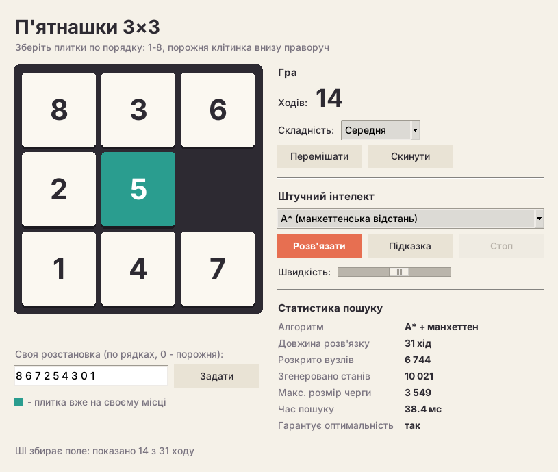
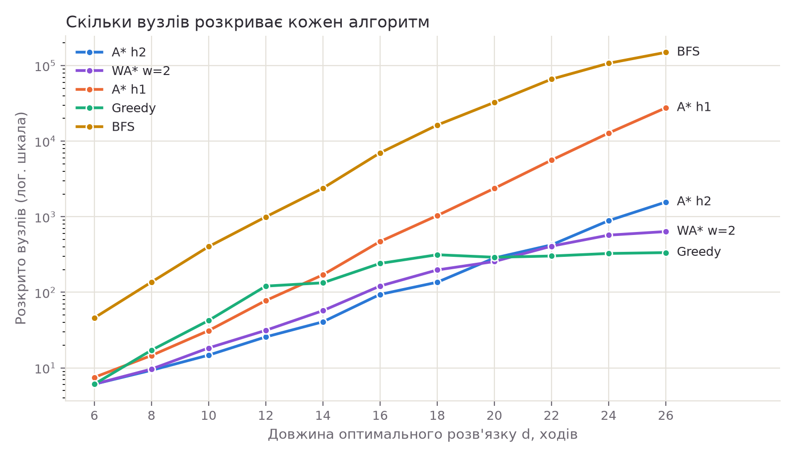

# 8-puzzle AI

Лабораторна робота №1 з курсу «Основи штучного інтелекту».

Гра «П'ятнашки» 3×3 (8-puzzle) і 4×4 (15-puzzle) з ШІ-розв'язувачем. Можна збирати поле
самостійно або доручити це алгоритму пошуку й подивитися, як він знаходить розв'язок.



## Можливості

- два розміри поля: 3×3 і 4×4 (перемикач «Розмір»);
- гра мишкою (клік на плитку поруч із порожньою) або стрілками на клавіатурі;
- перемішування трьох рівнів складності; завжди генеруються лише розв'язні розстановки;
- введення своєї розстановки з перевіркою розв'язності;
- автоматичне розв'язання з анімацією кожного ходу, кнопка «Стоп» (зупиняє і пошук, і показ);
- підказка наступного оптимального ходу;
- статистика пошуку: довжина розв'язку, кількість розкритих вузлів, розмір черги, час;
- плитки, що вже стоять на своєму місці, підсвічуються.

## Алгоритми

| Алгоритм | Пріоритет у черзі | Оптимальний розв'язок |
|---|---|---|
| BFS - пошук у ширину | черга FIFO | так |
| A* + h1 (плитки не на місці) | f = g + h1 | так |
| A* + h2 (манхеттенська відстань) | f = g + h2 | так |
| Зважений A* + h2, w = 2 | f = g + 2·h2 | ні, але не довше 2× оптимуму |
| Жадібний пошук + h2 | f = h2 | ні |

`g` - кількість уже зроблених ходів, `h` - оцінка кількості ходів, що лишилися.
Обидві евристики допустимі (не переоцінюють), тому A* завжди знаходить найкоротший розв'язок.

Зважений A* лежить між A* і жадібним пошуком: при w = 1 це звичайний A*, а при дуже великому w
він поводиться як жадібний. Множник w змушує алгоритм більше довіряти евристиці й сміливіше
йти до цілі, тому він розкриває набагато менше вузлів. Плата за це: розв'язок може бути
довшим за оптимальний, але не більше ніж у w разів.

## Поле 4×4

**Розв'язність.** На полі 3×3 кожен хід зберігає парність кількості інверсій, тому розв'язні
лише розстановки з парною кількістю інверсій. На полі 4×4 (парна ширина) вертикальний хід
змінює парність інверсій, але разом з нею змінюється й рядок порожньої клітинки. Тому
зберігається парність суми «інверсії + номер рядка порожньої клітинки знизу». У цільовому
стані вона дорівнює 0 + 1 = 1, отже розв'язні лише розстановки з непарною сумою.

**Складність пошуку.** У 3×3 всього 181 440 досяжних станів, а в 4×4 їх близько 10¹³.
Тому на 4×4:

- A* з манхеттенською відстанню знаходить оптимальний розв'язок для розстановок
  приблизно до 40-45 ходів за частки секунди, але повністю випадкові розстановки
  (у середньому ~52 ходи) для нього заскладні;
- зважений A* (w = 2) розв'язує повністю випадкові розстановки приблизно за секунду;
- жадібний пошук теж їх розв'язує і ще швидше, але шлях виходить у кілька разів довшим;
- BFS і A* з евристикою «плитки не на місці» реально працюють лише для неглибоких задач.

10 повністю випадкових розстановок 4×4, ліміт 500 000 вузлів:

| Алгоритм | Розв'язано | Середня довжина | Макс. час |
|---|---|---|---|
| A* + h2 | 0 з 10 | - | - |
| Зважений A* w = 2 | 10 з 10 | 66 ходів | 1.2 с |
| Жадібний + h2 | 10 з 10 | 182 ходи | 0.03 с |

Рівні складності для 4×4: перемішування на 10 і 30 ходів (легка, середня) і повністю
випадкова розстановка (складна). Кожен пошук має ліміт у 500 000 розкритих вузлів: якщо
його перевищено, гра повідомляє про це й не займає всю пам'ять. Пошук іде в окремому
потоці, тому вікно не зависає, а кнопка «Стоп» перериває його. Підказка спочатку пробує
звичайний A*, а якщо розстановка для нього заскладна, бере зважений A*.

Свою розстановку 4×4 вводять через пробіл, наприклад
`6 8 15 4 1 2 3 0 9 5 10 7 14 13 11 12`.

## Запуск

Потрібен Python 3.8+. Гра використовує лише стандартну бібліотеку (Tkinter).

```bash
python main.py
```

На Linux Tkinter інколи треба доставити: `sudo apt install python3-tk`.

## Тести

```bash
python -m unittest -v
```

## Експерименти

```bash
pip install matplotlib
python experiments.py              # 20 задач на кожну глибину 6..26
python experiments.py --per-depth 5
```

Експерименти проводяться на полі 3×3. Скрипт підбирає задачі з відомою довжиною оптимального розв'язку, запускає на них усі
алгоритми й зберігає таблиці в `results/summary.md`, сирі дані в `results/results.csv`
і графік `results/expanded_nodes.png`.

Середня кількість розкритих вузлів (20 задач на кожну глибину):

| d | A* h2 | WA* w=2 | A* h1 | Greedy | BFS |
|---|---|---|---|---|---|
| 10 | 15 | 18 | 31 | 42 | 402 |
| 16 | 94 | 121 | 470 | 241 | 7 001 |
| 20 | 284 | 256 | 2 375 | 291 | 32 591 |
| 26 | 1 564 | 637 | 27 618 | 335 | 149 680 |

На 3×3 зважений A* на глибоких задачах розкриває в 2-2.5 рази менше вузлів, ніж A* h2,
а його розв'язки довші за оптимальні лише на 0-11 % (жадібний пошук: на 50-130 %).



## Структура

```
main.py              запуск гри
experiments.py       порівняння алгоритмів
puzzle/
  board.py           стан поля 3×3 або 4×4, ходи, перевірка розв'язності
  heuristics.py      евристики h1 та h2
  solvers.py         BFS, A*, зважений A*, жадібний пошук, ліміт вузлів і зупинка
  gui.py             інтерфейс на Tkinter
tests/
  test_puzzle.py     модульні тести
```
