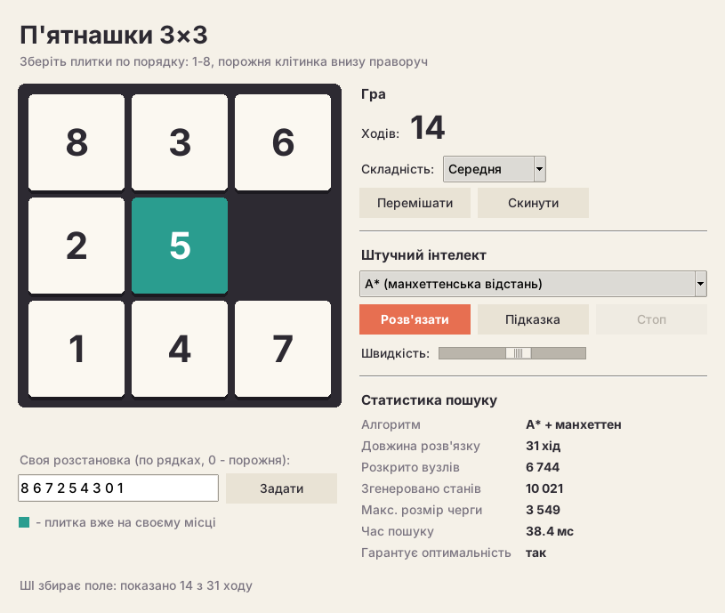
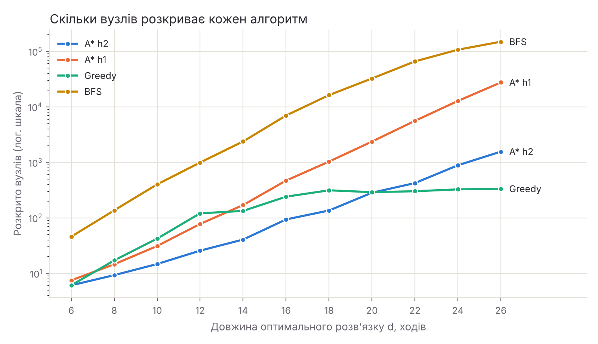

# 8-puzzle AI

Лабораторна робота №1 з курсу «Основи штучного інтелекту».

Гра «П'ятнашки» 3×3 (8-puzzle) з ШІ-розв'язувачем. Можна збирати поле самостійно
або доручити це алгоритму пошуку й подивитися, як він знаходить розв'язок.



## Можливості

- гра мишкою (клік на плитку поруч із порожньою) або стрілками на клавіатурі;
- перемішування трьох рівнів складності; завжди генеруються лише розв'язні розстановки;
- введення своєї розстановки з перевіркою розв'язності (парність інверсій);
- автоматичне розв'язання з анімацією кожного ходу, кнопка «Стоп»;
- підказка наступного оптимального ходу;
- статистика пошуку: довжина розв'язку, кількість розкритих вузлів, розмір черги, час;
- плитки, що вже стоять на своєму місці, підсвічуються.

## Алгоритми

| Алгоритм | Пріоритет у черзі | Оптимальний розв'язок |
|---|---|---|
| BFS - пошук у ширину | черга FIFO | так |
| A* + h1 (плитки не на місці) | f = g + h1 | так |
| A* + h2 (манхеттенська відстань) | f = g + h2 | так |
| Жадібний пошук + h2 | f = h2 | ні |

`g` - кількість уже зроблених ходів, `h` - оцінка кількості ходів, що лишилися.
Обидві евристики допустимі (не переоцінюють), тому A* завжди знаходить найкоротший розв'язок.

## Запуск

Потрібен Python 3.8+. Гра використовує лише стандартну бібліотеку (Tkinter).

```bash
python main.py
```

На Linux Tkinter інколи треба доставити: `sudo apt install python3-tk`.

## Тести

```bash
python -m unittest -v
```

## Експерименти

```bash
pip install matplotlib
python experiments.py              # 20 задач на кожну глибину 6..26
python experiments.py --per-depth 5
```

Скрипт підбирає задачі з відомою довжиною оптимального розв'язку, запускає на них усі
алгоритми й зберігає таблиці в `results/summary.md`, сирі дані в `results/results.csv`
і графік `results/expanded_nodes.png`.

Середня кількість розкритих вузлів (20 задач на кожну глибину):

| d | A* h2 | A* h1 | Greedy | BFS |
|---|---|---|---|---|
| 10 | 15 | 31 | 42 | 402 |
| 16 | 94 | 470 | 241 | 7 001 |
| 20 | 284 | 2 375 | 291 | 32 591 |
| 26 | 1 564 | 27 618 | 335 | 149 680 |



## Структура

```
main.py              запуск гри
experiments.py       порівняння алгоритмів
puzzle/
  board.py           стан поля, ходи, перевірка розв'язності
  heuristics.py      евристики h1 та h2
  solvers.py         BFS, A*, жадібний пошук
  gui.py             інтерфейс на Tkinter
tests/
  test_puzzle.py     модульні тести
```
